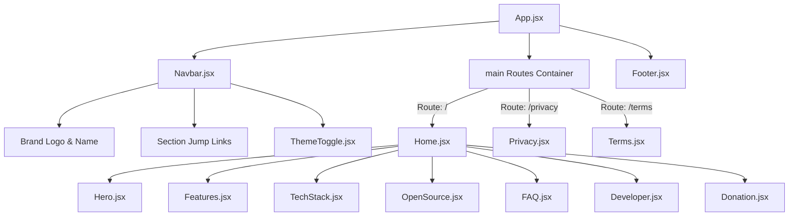

# Component Architecture

## Component Tree & Composition

## Theme Switching Architecture
Theme switching is managed in `src/components/ThemeToggle.jsx`:
- Queries the root document element (`document.documentElement`).
- Toggles the `data-theme` attribute between `"light"` and `"dark"`.
- Syncs the active preference with browser `localStorage.getItem("theme")`.
- CSS custom variables defined in `src/index.css` automatically adapt colors, shadows, and borders across all components.
