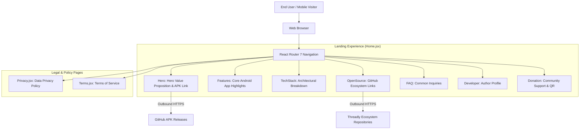

# Architecture Overview

## Product Goals
The **Threadly Launch Website** is the public storefront and download portal for the Threadly ecosystem. Its primary responsibilities include:
1. **Product Presentation**: Highlighting core native Android features (real-time chat, story sharing, private profiles, offline Room caching, media feeds).
2. **Binary Distribution**: Directing mobile visitors to verified GitHub APK releases (`https://github.com/rashidekbal/threadly/releases`).
3. **Open-Source Transparency**: Showcasing system architecture, tech stacks, and links to all public micro-repositories.
4. **Legal Compliance**: Hosting public Privacy Policy and Terms of Service agreements.

## System Topology

## Tech Stack & Constraints
- **Framework**: React 19 (`react`, `react-dom`).
- **Routing**: React Router 7 (`react-router-dom`).
- **Build Engine**: Vite 7 (`vite`, `@vitejs/plugin-react`).
- **Styling**: CSS Custom Properties (`--primary-color`, `--card-bg`, `--text-primary`) supporting instantaneous Light/Dark theme switching without page reloads.
