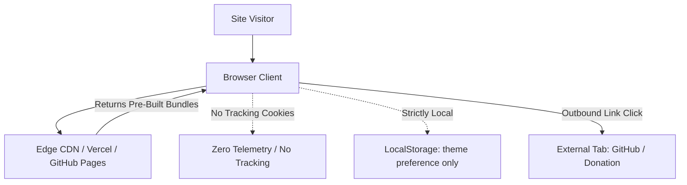

# Process Isolation & Security Model

## Zero-Collection Privacy Model

The Launch Website does not capture, store, or transmit personally identifiable user data.

## Security Best Practices
1. **Target Hardening**: All external links (`<a>` elements pointing to GitHub, releases, or developer socials) enforce `rel="noopener noreferrer"` and `target="_blank"`.
2. **Static Surface**: The website executes zero backend server code, eliminating database injection and server-side privilege escalation vectors.
3. **No Dynamic Code Evaluation**: Zero use of `eval()`, `dangerouslySetInnerHTML`, or external unvetted scripts.
